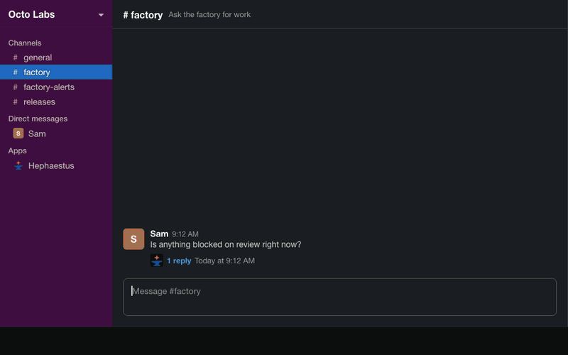

<p align="center"></p>

Hephaestus turns your repos into a software factory. You ask for work, AI agents build it on your own machines, a second agent reviews it, and Hephaestus merges it when your policy allows.

<p align="center"></p>

## Features

- Ask for work in chat (Discord, Telegram, or Slack), on the dashboard, or by opening a GitHub issue.
- A coding agent implements each task in a [T3 Code](https://github.com/pingdotgg/t3code) thread on one of your worker machines.
- An agent from a different provider reviews each PR.
- A per-project merge policy decides what merges on its own and what waits for you.
- A merge that breaks the default branch can be reverted automatically.
- On a schedule, the factory proposes improvements to its own instructions for you to approve.
- A dashboard on your LAN shows what needs you, what is running, and the full history.
- Your own Claude, Codex, Hermes, and T3 setup is left untouched, and uninstall removes everything Hephaestus added.

## Requirements

On the host that runs Hephaestus:

- Linux with a systemd user session
- Node.js 22.13 or newer
- [T3 Code](https://github.com/pingdotgg/t3code), with your worker machines linked to it
- [Hermes Agent](https://github.com/NousResearch/hermes-agent)
- The GitHub CLI (`gh`), signed in

On each worker: T3 Code, Claude Code, the Codex CLI, `git`, `python3`, and `gh` signed in to an account that can read your repos.

## Install

```sh
git clone https://github.com/greerviau/hephaestus.git
cd hephaestus
npx -y npm@11 ci
npm run build
node dist/cli.js install
```

Install asks for a dashboard password of 12 or more characters, then starts the service. Open `http://<host>:7700` (the default port), sign in, and finish setup on the dashboard:

1. **Config**: name a private repo to store config versions, such as `you/hephaestus-config`. Hephaestus creates it if needed.
2. **Workers**: click **Use as a worker** on each machine that should run tasks. Then sign in its factory agents as the page shows. A worker is ready when its checks pass.
3. **Projects**: add each repo and pick a policy preset.
4. **Config > Models**: choose the models the factory uses.
5. **Chat** (optional): connect a Discord, Telegram, or Slack bot.

## Use it

Ask for work in chat, with **Request work** on the **Work** page, or by opening an issue on a factory repo and admitting it. **Home** lists everything that needs you: merges to approve, issues to admit, improvement proposals, and workers to sign in. **Pause** in the sidebar stops new tasks from starting.

Each project's policy starts from a preset, and you can change any setting:

| Policy     | Merges on its own when                                                                                                             |
| ---------- | ---------------------------------------------------------------------------------------------------------------------------------- |
| `strict`   | never: every merge waits for you                                                                                                   |
| `standard` | checks pass and the reviewer approved the exact head commit, unless the PR touches an escalation path such as `.github/workflows/` |
| `yolo`     | checks pass, with no review                                                                                                        |

## Update and uninstall

```sh
node dist/cli.js update
```

Update pulls `origin/main`, rebuilds, and restarts the service. It rolls back if the build fails. The dashboard also shows an **Update now** button when a new version is available.

```sh
node dist/cli.js uninstall
```

Uninstall removes Hephaestus from every worker and the host. Afterwards, revoke any tokens you gave the factory agents.

## Documentation

- [Install and uninstall](docs/install.md)
- [Configuration](docs/configuration.md)
- [Dashboard](docs/dashboard.md)
- [Workers](docs/workers.md)
- [The factory](docs/factory.md)
- [Factory Hermes](docs/hermes.md)
- [T3 integration](docs/t3.md)
- [Development](docs/development.md)
